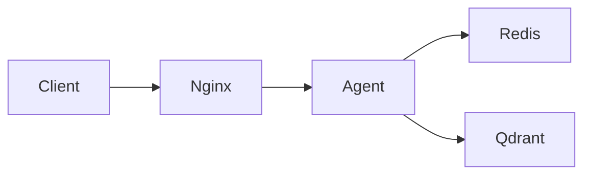

# Day 14 — Mission Answers

## Part 1: Localhost vs Production
### Exercise 1.1 — Anti-patterns
1. Hardcode API key: [01-localhost-vs-production/develop/app.py:17](01-localhost-vs-production/develop/app.py#L17). Secret có thể nằm vĩnh viễn trong lịch sử Git.
2. Hardcode connection string chứa password: [01-localhost-vs-production/develop/app.py:18](01-localhost-vs-production/develop/app.py#L18).
3. Debug luôn bật: [01-localhost-vs-production/develop/app.py:21](01-localhost-vs-production/develop/app.py#L21).
4. Log API key bằng print: [01-localhost-vs-production/develop/app.py:34](01-localhost-vs-production/develop/app.py#L34); log aggregator cũng làm lộ key.
5. Chỉ bind localhost: [01-localhost-vs-production/develop/app.py:51](01-localhost-vs-production/develop/app.py#L51); container/cloud không nhận traffic bên ngoài.
6. Port 8000 cố định thay vì env PORT; reload=True không thích hợp production.
7. Thiếu /health và /ready để nền tảng quyết định restart hoặc route traffic.
8. Không có lifespan cleanup và cơ chế quản lý cấu hình.

### Exercise 1.2 — Chạy bản develop
Gọi POST /ask?question=Hello trả 200. Gửi JSON như ví dụ cũ trả 422 vì hàm nhận query param.
Output thật: [exercise-http-evidence.txt](reports/exercise-http-evidence.txt).
Bản này chạy được chưa có nghĩa là production-ready.

### Exercise 1.3 — So sánh
| Tính năng | Develop | Production mẫu | Ý nghĩa |
|---|---|---|---|
| Config | Literal trong app.py | Dataclass đọc os.getenv trong config.py | Cùng code chạy ở nhiều môi trường, không commit key |
| Health/readiness | Thiếu | /health và /ready | Phân biệt restart process và tạm ngừng traffic |
| Logging | print, lộ secret | Có cấu trúc và field ngữ cảnh | Dễ tìm kiếm; cần json.dumps/formatter chuẩn để escape |
| Shutdown | Không cleanup | Lifespan startup/shutdown | Đóng tài nguyên sau khi drain request |
| Network | localhost, port cố định | 0.0.0.0 và settings.port | Nhận traffic container, theo port platform |

Ví dụ sửa port: [01-localhost-vs-production/production/config.py:18](01-localhost-vs-production/production/config.py#L18).
Lưu ý code mẫu logging dùng format JSON và message có thể đã json.dumps gây lồng quote; Part 6 dùng JsonFormatter chuẩn để tránh lỗi này.

## Part 2: Docker
### Exercise 2.1
1. Base image develop: python:3.11, từ 02-docker/develop/Dockerfile.
2. Working directory: /app.
3. COPY requirements.txt trước source để pip layer dùng cache khi chỉ sửa code; thay requirements mới phải cài lại.
4. CMD cung cấp command/argument mặc định, docker run có thể thay. ENTRYPOINT định nghĩa executable; argument docker run thường được nối vào nó. Dạng exec giúp truyền signal trực tiếp.

### Exercise 2.2–2.3
Build từ gốc repo vì đường dẫn COPY tính theo build context.
Builder cài compiler/dependencies; runtime chỉ mang package và source cần thiết, bỏ build tools.
Multi-stage không tự bảo đảm nhỏ: nếu copy thừa hoặc dependencies lớn thì image vẫn lớn.
Develop: 406.57 MiB; production: 54.75 MiB; giảm 86.53% so với develop. Nguồn: reports/docker-image-sizes.json (byte inspect thực).
Kết quả HTTP container: reports/docker-basic-http.txt. Image Part 6 được checker đo 56 MB theo định dạng script, không dùng số đó để thay số image Part 2.

### Exercise 2.4

Stack có agent, Redis, Qdrant và Nginx cùng network internal. depends_on với health condition giúp khởi động đúng thứ tự.
Đây là sơ đồ dịch vụ cấu hình; mock agent mẫu chưa thực hiện đầy đủ truy vấn Redis/Qdrant.
HTTP qua Nginx: reports/part2-nginx.txt.

## Part 3: Cloud Deployment
### Exercise 3.1/3.2
Đã deploy public tại https://day14-production-agent-haua.onrender.com với Redis trên Render. Bốn lệnh CP6 đạt 200/200/401/200; xem reports/public-deployment.json và screenshots/.
Cấu hình chuẩn bị trong 06-lab-complete/render.yaml; xem [DEPLOYMENT.md](DEPLOYMENT.md).
Criterion 12 của checker xác nhận config; public-deployment.json bổ sung bằng chứng endpoint cloud thực.

Railway dùng TOML chọn Dockerfile builder, healthcheckPath và restart policy; Redis là service được tạo và nối REDIS_URL riêng.
Render Blueprint dùng YAML mô tả cả web Docker và Key Value, kết nối REDIS_URL bằng fromService, AGENT_API_KEY dùng generateValue.
Render đường dẫn Docker tính từ repo root; Blueprint Path chọn 06-lab-complete/render.yaml. Không nhập secret vào code.

### Exercise 3.3 — Cloud Run
cloudbuild.yaml chạy pip + pytest trước; test thành công mới build Docker image gắn COMMIT_SHA và latest.
Bước tiếp theo push image lên registry rồi gcloud run deploy ở asia-southeast1.
Deploy đặt tài nguyên, timeout, min/max instances và inject secret từ Secret Manager.
service.yaml mô tả Knative Service, concurrency 80, autoscaling 1–10 và liveness /health, startup /ready.
Đây là mô tả file mẫu; chưa chạy GCP. File pipeline mẫu và service.yaml là hai cách deploy, không tự bảo đảm mọi setting được đồng bộ.

## Part 4: API Security
### Exercise 4.1–4.3 — HTTP thực tế
**1.2 query request**

```http
HTTP 200
{"answer":"Agent đang hoạt động tốt! (mock response) Hỏi thêm câu hỏi đi nhé."}
```

**1.2 JSON mismatch**

```http
HTTP 422
{"detail":[{"type":"missing","loc":["query","question"],"msg":"Field required","input":null}]}
```

**4.1 missing key**

```http
HTTP 401
{"detail":"Missing API key. Include header: X-API-Key: <your-key>"}
```

**4.1 correct key**

```http
HTTP 200
{"question":"Hello","answer":"Agent đang hoạt động tốt! (mock response) Hỏi thêm câu hỏi đi nhé."}
```

**4.2 no JWT**

```http
HTTP 401
{"detail":"Authentication required. Include: Authorization: Bearer <token>"}
```

**4.3 authenticated request 1**

```http
HTTP 200
{"question":"Docker","answer":"Container là cách đóng gói app để chạy ở mọi nơi. Build once, run anywhere!","usage":{"requests_remaining":9,"budget_remaining_usd":1.8e-05}}
```

**4.3 authenticated request 11**

```http
HTTP 429
{"detail":{"error":"Rate limit exceeded","limit":10,"window_seconds":60,"retry_after_seconds":59}}
```

Output đầy đủ response và header: [exercise-http-evidence.txt](reports/exercise-http-evidence.txt).
Lấy JWT bằng POST /auth/token với tài khoản demo student/demo123, giữ token trong process rồi gửi Bearer; không ghi JWT vào bài.
Sau 10 request hợp lệ, bản production mẫu trả 429; request bị chặn không gọi LLM.
Bản API-key mẫu trả 403 nếu sai key; Part 6 dùng 401 cho cả thiếu/sai theo hợp đồng chấm.

### Exercise 4.4 — Cost guard
Kiểm tra budget trước LLM; tính input/output tokens theo bảng giá mô phỏng rồi cộng usage sau request.
Part 6 dùng Redis daily/monthly keys theo UTC và INCRBYFLOAT trong transaction, chia sẻ giữa workers, ngày/tháng mới có key mới.
Rate limit bảo vệ tốc độ/sức tải, cost guard bảo vệ tổng ngân sách. Request ít nhưng prompt dài vẫn tốn nhiều tiền.
Giới hạn: check trước và ghi cost sau chưa reserve chi phí của các request đồng thời; có thể vượt budget bằng lượng đang in-flight.
Nếu dùng LLM thật cần reserve upper bound atomically và settle theo usage trả từ provider; token ở bài này chỉ là ước lượng của mock.

## Part 5: Scaling & Reliability
### Exercise 5.1–5.3
/health là liveness: process còn sống; /ready là readiness: dependency sẵn sàng.
Redis hỏng thì /health vẫn 200, /ready 503 và /ask 503; tránh vòng restart vô ích do lỗi dependency.
Uvicorn ngừng nhận request mới, drain request rồi chạy lifespan cleanup khi SIGTERM. Không ghi đè signal handler của nó.
Bằng chứng SIGTERM thực tế Linux trong reports/production-readiness-linux.txt: request vẫn 200, exit 0; docker stop 0.6 giây.

### Exercise 5.4–5.5
RAM thuộc riêng từng worker/container: request tiếp theo có thể tới instance khác và mất history hoặc quota.
Redis chia sẻ session, sorted-set quota và budget cho các instance.
Chạy docker compose -p k5-day14-scaling up -d --build --scale agent=3 rồi test_stateless.py.
Bằng chứng: reports/part5-stateless.txt. Script gửi 5 câu chung session, đọc lại history, không tự tắt instance.
Graceful shutdown dùng để rolling update: stop instance cũ sau khi bỏ khỏi traffic, chờ drain rồi thay instance mới.

## Part 6: Final Project
Các module trong 06-lab-complete/app/ đã được triển khai. Rate limiter dùng Lua nguyên tử và thời gian Redis để tránh race giữa workers.
API key so sánh constant-time, key trong Redis được băm SHA-256; request log không chứa key/câu hỏi.
Compose Redis có AOF + volume; Docker dùng hai stage, non-root, HEALTHCHECK và exec uvicorn nghe PORT.
Môi trường kiểm tra: GitHub Actions Ubuntu 26.04, Python 3.11.18, Docker 29.4.2.
Nguồn: [workflow run](https://github.com/xuannghia2/K5-L3B-DAY14-CanXuanNghia-2A202603805-Deployment-Benchmark-Observability/actions/runs/45785321467).
Script chấm và golden dataset giữ nguyên. Đã chạy thêm integration test cạnh tranh 30 request, chỉ 5 được nhận, reload vẫn bị 429.

```text
  📋 Checklist Deliverable
     ✅ Dockerfile (multi-stage, < 500 MB)
     ✅ docker-compose.yml (agent + redis)
     ✅ .dockerignore
     ✅ Health check endpoint (GET /health)
     ✅ Readiness endpoint (GET /ready)
     ✅ API Key authentication
     ✅ Rate limiting
     ✅ Cost guard
     ✅ Config từ environment variables
     ✅ Structured logging
     ✅ Graceful shutdown
     ✅ Public URL ready (Railway / Render config)
----------------------------------------------------------------
  Result: 12/12 tiêu chí đạt · 43/43 checks passed
  🎉 PASS 12/12 — PRODUCTION READY! Deploy nào!
================================================================

```

## AI log
- Công cụ: OpenAI Codex.
- Yêu cầu: đọc README/RULES/CHECKPOINTS/SUBMISSION/RUBRIC; triển khai TODO Part 6, metric độ dài câu hỏi, sửa KB HPA/JWT, viết CI và tài liệu bài nộp.
- Kết quả: code/config và scripts tái chạy, load/eval JSON, kết quả checker Linux; không sửa script chấm hay golden dataset.
- Kiểm tra do agent thực hiện: 28 static checks, API HTTP thực, 7 lượt load 300 requests, eval v1/v2/fixed, full checker Linux 43/43 và integration tests Redis.
- Người học cần tự đọc code, chạy lại và giải thích từng tiêu chí, con số trước khi nộp; không khẳng định đã tự thực hiện các bước khi chưa làm.
- Các giá trị đo lấy từ JSON/CSV/log thật; cloud đã được triển khai và kiểm chứng, mô tả ở DEPLOYMENT.md.
